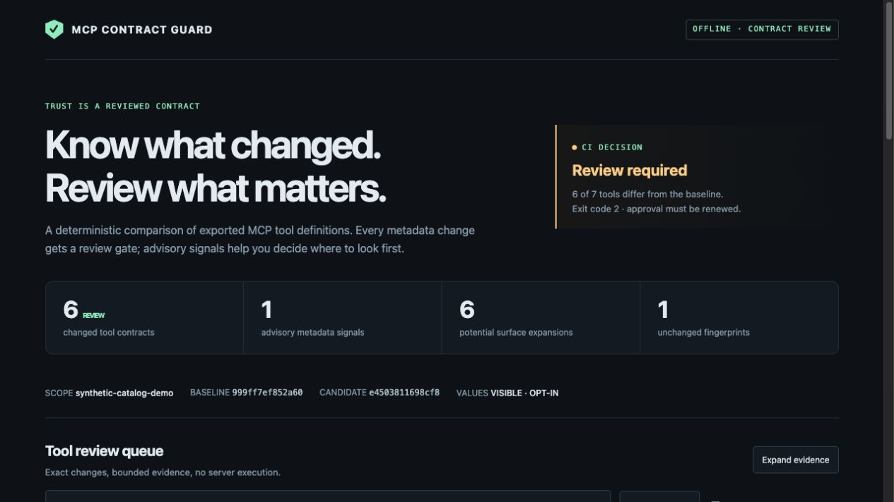

# MCP Contract Guard

[](https://github.com/demier-demier/mcp-contract-guard/actions/workflows/ci.yml)

**An offline review gate for changes in exported MCP tool definitions.**

An MCP tool can keep its name while its description, schema, or claimed behavior changes. Contract Guard compares a current `tools/list` export with an explicitly reviewed baseline, then produces precise evidence for another human review. It never starts a server, connects to a target, calls a tool, or invokes an AI model.

**[Open the live browser demo](https://bernardo-demier-ai-lab.fancy-fly-9200.chatgpt.site/mcp-contract-guard/)** — no installation or account required.



Open [the standalone demo](docs/demo.html) after downloading this repository, or inspect [its JSON evidence](docs/results.json). The demo uses a synthetic catalog: one added tool, one removed tool, four changed tools, and one unchanged tool.

## Try it online

Paste or choose two exported `tools/list` JSON files, select the left export as your review reference, and compare. The browser computes the fingerprints, gate, differences, and advisory findings with the **same core as the CLI**. Try the bundled drift, unchanged, description-only, and invalid-input examples; inspect per-tool evidence and download JSON or SARIF. Changing an input invalidates the previous verdict until you compare again.

This is an actual browser computation, not a replay. Your exports stay in the browser's memory; the app has no input API, analytics, remote model, local storage, or server-connection feature. Static assets are downloaded from the hosting service. File contents are decoded as strict UTF-8, bounded to 2 MiB per side, and never sent by the app. Names and paths remain visible in redacted reports; values require explicit opt-in. Hosting and browser extensions remain separate trust boundaries.

The checked-in [`docs/demo.html`](docs/demo.html) is a **recorded report** for the fixed synthetic fixture. It remains useful offline, separately from the live comparison app.

## What it does

- SHA-256 fingerprints for complete tool definitions, input schemas, descriptions, and annotations.
- Detects additions, removals, metadata changes, and unknown extension-field changes. A harmless-looking description change still requires review.
- Highlights possible input or behavior expansion: newly accepted properties, removed requirements, expanded enums, and changes in untrusted annotation hints.
- Labels instruction-like text and invisible formatting as **heuristics**, with no claim that a hit proves an attack or a miss proves safety.
- Produces deterministic JSON, SARIF 2.1.0, and one self-contained HTML file with search, status filters, signal filters, and per-tool evidence.
- Rejects ambiguous exports, duplicate names/keys, incomplete pagination, malformed inputs, and common invalid JSON Schema keyword shapes before comparison.

## Run locally

Requires Node.js **22 or later**. The lockfile pins the shared SHA-256 library (`@noble/hashes`), compiler, build tooling, and type definitions. There is no server or model dependency.

```sh
npm ci --ignore-scripts
npm test
npm run demo:check
node dist/cli.js --help
```

Inspect the actual exported definitions before acknowledging a baseline. Use a scope label that identifies the server identity, environment, authorization context, and export policy in your own controlled inventory; do not put credentials or personal data in it.

```sh
node dist/cli.js baseline \
  --input fixtures/reviewed.json \
  --scope synthetic-catalog-demo \
  --reviewed \
  --output reviewed-baseline.json

node dist/cli.js compare \
  --baseline reviewed-baseline.json \
  --input fixtures/candidate.json \
  --scope synthetic-catalog-demo \
  --format html \
  --output review.html
```

The example comparison exits **2** because its contracts changed. `--format json` is the default; use `--format sarif` for code-scanning ingestion. Without `--output`, comparison writes the report to stdout. Existing output files are never overwritten. The baseline command requires both `--reviewed` and an output path; it cannot silently approve a new snapshot during comparison.

| Exit | Meaning | CI treatment |
| --- | --- | --- |
| `0` | Baseline created, or no tool-contract change | Continue only within the scope of this check |
| `2` | One or more tools added, removed, or changed | Pause for review |
| `1` | Invalid input, unsupported format, scope mismatch, or I/O failure | Fail the job |

An unchanged tool may still have advisory heuristic findings. Exit `0` means **no observed definition change**, not that a server is safe. Every definition change triggers exit `2`, independently of those heuristics.

## Input and evidence policy

Accepts `{ "tools": [...] }` or a JSON-RPC response with `result.tools`. Export and combine **all** pages first, preserving the authorization context. An export with any `nextCursor` field is rejected. This tool cannot establish completeness if an exporter silently omits tools.

Object keys and the top-level tool list are sorted for fingerprinting. All other arrays retain their order, including schema arrays: tuple positions must never be collapsed. Consequently, a `required` or `enum` reorder also requests review; this is intentionally conservative, not a semantic equivalence proof. Transport IDs and response-level metadata are outside the tool-contract fingerprint.

Report values are **omitted by default**. Tool names, scope labels, evidence paths, hashes, counts, and fixed finding messages remain visible. This is data minimization, not anonymization: names and property keys may reveal information, and hashes permit guessing attacks on low-entropy values. `--include-values` explicitly enables bounded value previews; the synthetic demo uses it. Baselines retain full metadata because comparison requires it. Keep real exports and baselines private. See [the complete format and limits](docs/FORMAT.md).

## Why this exists

[OWASP's client-side tool risk gating guidance](https://owasp.github.io/www-project-mcp-top-10/2025/recommended-controls/Client-Side-Tool-Risk-Gating) describes metadata changes after approval as a reason to fingerprint definitions and require renewed review. This project implements the **offline snapshot review** portion of that idea. It does not integrate a live MCP host or enforce permissions at invocation time.

The [MCP tools specification](https://modelcontextprotocol.io/specification/latest/server/tools) treats annotations as untrusted unless they come from trusted servers. Contract Guard never treats `readOnlyHint` or `destructiveHint` as evidence of actual behavior. The separate [MCP security guidance](https://modelcontextprotocol.io/specification/latest/basic/security_best_practices) covers runtime concerns such as authorization and token handling that an export diff cannot test.

## Development and packaging

```sh
npm test                 # build plus parser, contract, renderer, and CLI tests
npm run demo             # regenerate synthetic baseline and all demo artifacts
npm run demo:check       # byte-for-byte deterministic artifact check
npm run web:build        # type-check and bundle browser app into web/dist/
npm run build
npm pack --ignore-scripts
```

The package contains compiled JavaScript, declarations, documentation, and synthetic fixtures. Install the resulting `.tgz` locally to use the `mcp-contract-guard` command. The manifest is private to prevent accidental registry publication; GitHub source publication is independent. CI tests Node 22 and 24. No production adoption, production-server integration, formal security verification, or AI inference is claimed.

The static browser build is `web/dist/`; its assets are relative and work under `/mcp-contract-guard/`. `web/` contains the source and `scripts/build-web.mjs` bundles it with pinned esbuild. Generated browser files are ignored by Git. Deploy the entire directory, including `THIRD_PARTY_NOTICES.txt`. Tests execute the browser-targeted comparison bundle without Node globals and compare its JSON/SARIF output with the CLI engine, alongside file-boundary and build checks. Browser interaction QA is separate from these automated tests.

[Threat model](docs/THREAT-MODEL.md) · [Format and limits](docs/FORMAT.md) · [Implementation provenance](PROVENANCE.md)
